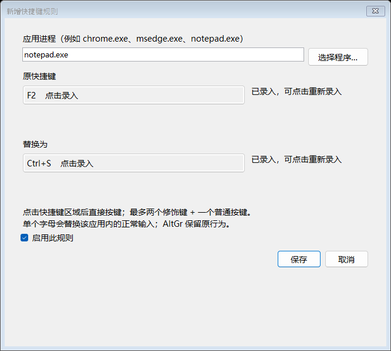
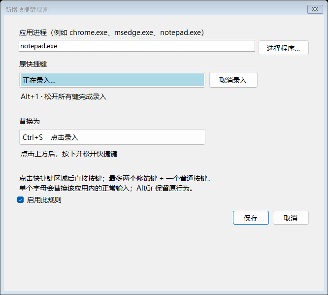
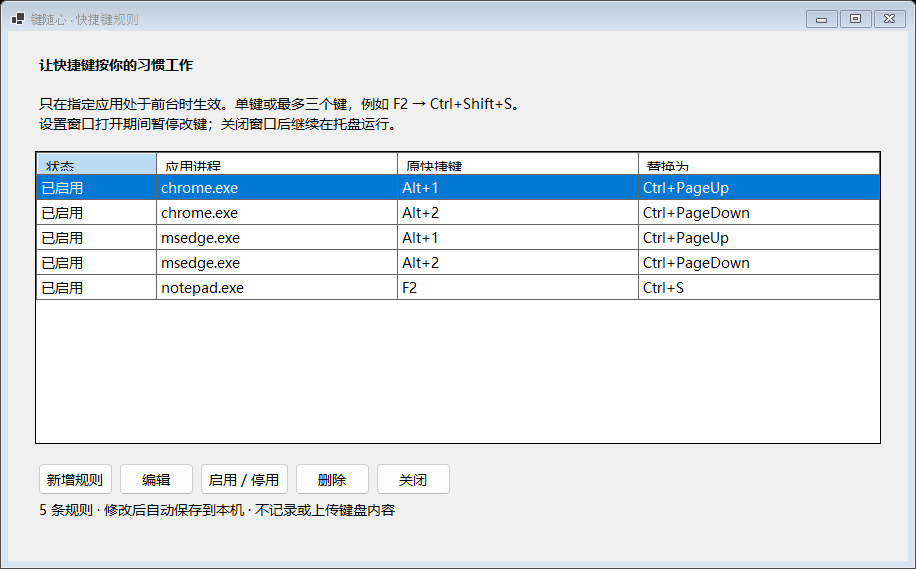

# 键随心 0.2.0-beta.2 测试版：图解使用教程

下面的截图来自软件在 Windows 上实际运行的界面，展示规则列表、新增规则和按键录入过程。列表中的记事本规则是教程添加的示例，首次安装只有 Chrome / Edge 四条默认规则。

## 1. 下载、安装并打开

普通 Intel / AMD 电脑下载 [x64 安装包](https://github.com/sunholdshen/tabhop/releases/download/v0.2.0-beta.2/TabHop-0.2.0-beta.2-win-x64-Setup.exe)；Windows ARM 电脑下载 [ARM64 安装包](https://github.com/sunholdshen/tabhop/releases/download/v0.2.0-beta.2/TabHop-0.2.0-beta.2-win-arm64-Setup.exe)。不确定时，到 Windows“设置 → 系统 → 关于”查看“系统类型”。下载 Setup.exe，不要下载 Source code 压缩包。

运行安装包，按提示安装，完成后启动键随心。已有 0.1 版可直接覆盖安装。
当前测试版未签名，可能出现“未知发布者”。确认来自本项目的官方 Release 后，如出现 SmartScreen 提示，可以点“更多信息 → 仍要运行”。不要关闭 Windows 安全防护。

## 2. 看懂默认规则

一行规则有四个部分：**状态、应用进程、原快捷键、替换为**。

| 应用进程 | 原快捷键 | 替换为 | 效果 |
| --- | --- | --- | --- |
| chrome.exe / msedge.exe | Alt+1 | Ctrl+PageUp | 切换左侧标签页 |
| chrome.exe / msedge.exe | Alt+2 | Ctrl+PageDown | 切换右侧标签页 |

初次使用无需修改这些规则。点击“关闭”，打开有多个标签页的 Chrome 或 Edge，就可以测试。

**设置窗口打开期间，所有改键都会临时暂停。关闭设置窗口后恢复；程序仍在托盘运行。**

## 3. 新增一条：记事本 F2 → Ctrl+S

1. 点击“新增规则”。
2. “应用进程”填写 `notepad.exe`。也可以点“选择程序”找到对应 EXE；程序只保存文件名。
3. 点击“原快捷键”下的“点击录入”，按下 `F2` 后松开。
4. 点击“替换为”下的“点击录入”，按住 `Ctrl`、按下 `S`，然后松开所有键。
5. 保持“启用此规则”勾选，点击“保存”。

这样，F2 只在记事本处于前台时变成 Ctrl+S。它不会让其他应用的 F2 一起改变。若你的应用进程名不是 notepad.exe，请在任务管理器“详细信息”中确认实际 EXE 名称。

如果想设置三键组合，例如 Ctrl+Shift+S，点击录入后直接按下该组合，再松开所有键。每侧最多两个修饰键加一个普通按键。

录入时会显示正在识别的组合，松开后完成；Enter、Tab、Esc 可以作为快捷键录入，不会在录入期间触发对话框保存、跳转或取消。按错可点“取消录入”，原值保留；切换窗口也会取消。超出支持范围会提示重新录入。系统安全组合键不保证可拦截，请不要用 Ctrl+Alt+Delete 或 Win+L 测试。

## 4. 保存后关闭设置，再测试

列表中新增了 `notepad.exe / F2 / Ctrl+S`，修改已自动保存。

点击“关闭”，打开记事本，输入一段测试文字，然后按 F2。对于尚未保存的新文档，正常情况下会出现保存窗口；对于已保存的文档，会保存当前修改。

测试后可以再回 Chrome / Edge，确认原来的 Alt+1 / Alt+2 仍然正常。

## 5. 编辑、停用和日常使用

- 双击右下角托盘图标打开设置；图标可能在“显示隐藏的图标”里。
- 选中一行，点“编辑”，修改应用或两侧快捷键后保存。编辑与新增使用同一套界面。
- “启用 / 停用”只控制当前选中规则，适合暂时关闭但保留配置。
- “删除”移除当前规则。
- 右键托盘可以暂停全部映射、开启开机启动或退出。退出后按键恢复原来的行为。
- 开机启动默认关闭，开启后在当前用户登录 Windows 时静默启动。

## 设计思路

**先指定应用，再定义替换。** 同一个按键在不同软件里用途不同，按前台应用匹配可以减少互相干扰。匹配使用进程文件名，相同 EXE 文件名的不同安装会使用同一组规则。

**来源与目标结构一致。** 两边都直接按键录入，并显示识别到的组合，不需要对照下拉框寻找按键。松开所有键才确认，避免只按下修饰键就提前录入。首版专注单次快捷键替换，不加入宏和多步骤动作。

**配置时暂停，使用时驻留托盘。** 避免编辑规则时触发已有映射；平时不占任务栏。每条规则能单独停用，托盘还能一次暂停全部改键。

**配置保存在本机。** 无需账号或联网，只保存规则，不记录输入内容。EXE 版配置位于 `%LOCALAPPDATA%\TabHop\rules.json`，升级和 EXE 卸载会保留，方便重新安装。

## 测试时需要注意

目标应用必须支持目标快捷键。普通权限运行的键随心 不保证能控制管理员应用；部分系统保留快捷键也不能替换。请先用 F2、Alt+数字等组合测试，单个字母改键会覆盖目标应用中的正常打字。

如果没有反应，依次检查：设置窗口是否关闭、规则是否启用、托盘是否暂停、前台应用进程名是否正确、目标快捷键在该应用中是否有效。

本版本已通过 Windows x64 自动安装、升级、卸载及界面测试；真实键盘操作和 ARM64 真机体验仍需要用户验证。反馈时请提供 Windows 版本、应用 EXE 名称、来源和目标快捷键、发生现象，不要提供敏感输入。
