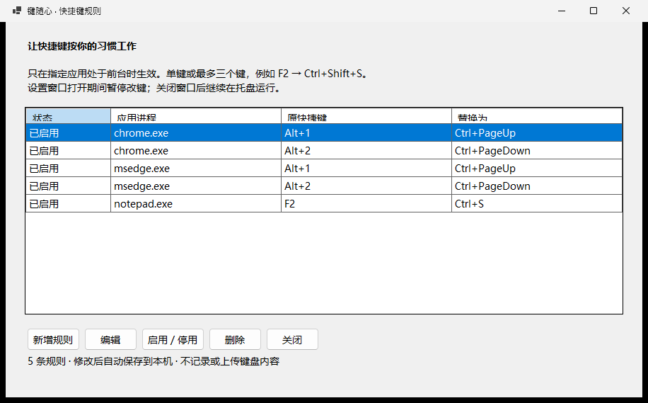

# 键随心

原名 TabHop，按应用自定义快捷键。
**为不同 Windows 应用配置自己的快捷键。免费使用，源码不公开。**

把指定应用中的单键或组合键替换为另一个快捷键。例如，在记事本中用 F2 保存；在 Chrome / Edge 中用 Alt+1、Alt+2 切换标签页。带托盘、暂停和可选的开机启动。

## 下载 0.2.0 测试版

| 电脑类型 | 下载 |
| --- | --- |
| 普通 Intel / AMD 电脑 | [Windows x64 安装包](https://github.com/sunholdshen/tabhop/releases/download/v0.2.0-beta.2/TabHop-0.2.0-beta.2-win-x64-Setup.exe) |
| Windows ARM 电脑 | [Windows ARM64 安装包](https://github.com/sunholdshen/tabhop/releases/download/v0.2.0-beta.2/TabHop-0.2.0-beta.2-win-arm64-Setup.exe) |

[版本说明与 SHA-256 校验文件](https://github.com/sunholdshen/tabhop/releases/tag/v0.2.0-beta.2)

支持 Windows 10 22H2 / Windows 11。安装包包含运行环境，无需另装 .NET，无需管理员权限。可以覆盖安装旧版，已有规则会保留。

这是 **v0.2.0-beta.2 测试版**，尚未代码签名，Windows 可能提示“未知发布者”。请核对本仓库地址与校验值；如出现 SmartScreen“Windows 已保护你的电脑”，确认来源后选择“更多信息 → 仍要运行”。如果被组织策略阻止，请联系设备管理员，不要关闭安全防护。Microsoft Store 版本尚未上架。

## 快速开始

1. 安装并启动键随心，默认已有 Chrome / Edge 的四条切标签规则。
2. 点“新增规则”，填应用进程名，分别点击“原快捷键”和“替换为”，直接按键录入，然后保存。
3. **关闭设置窗口后规则才开始生效**，程序继续留在托盘。
4. 双击托盘图标重新打开设置；右键可暂停全部改键、开启登录自启动或退出。

[图解教程](QUICKSTART.md) · [完整使用说明](USER-GUIDE.md) · [更新记录](CHANGELOG.md) · [反馈问题](https://github.com/sunholdshen/tabhop/issues/new/choose)

## 新版变化

快捷键改为直接按键录入：点击区域，按下组合键，松开后自动填入。按错可取消重录，切换窗口自动取消。应用更名为“键随心”，旧规则和开机启动选择保留；下载地址和内部程序文件名继续沿用 TabHop，以保持升级兼容。

## 支持范围

- 每条规则仅在对应应用处于前台时生效；按 EXE 文件名匹配，不区分大小写。
- 来源和目标都支持一个普通按键，加最多两个 Ctrl / Alt / Shift / Win 修饰键，共最多三个键，例如 F2、Alt+1、Ctrl+Shift+S。
- 可新增、编辑、启停和删除规则，自动保存到本机。
- 不包含鼠标、连续宏、多步骤动作、小键盘、媒体键或纯修饰键改写。不是任意三个普通字母同时按下。
- AltGr 保留原行为；系统保留快捷键、管理员应用或不接受模拟输入的应用不保证支持。目标应用本身需要支持目标快捷键。

## 免费使用，源码不公开

允许个人和商业用途免费使用官方程序。键随心采用[专有软件许可](LICENSE)，此公开仓库仅用于产品介绍、下载和反馈。
Release 页面自动生成的 “Source code” 压缩包只包含本仓库的公开文档与图片；请下载上面的 `.exe` 安装包。
第三方组件的许可保留在 [THIRD-PARTY-NOTICES.txt](THIRD-PARTY-NOTICES.txt)。

## 隐私

键随心离线运行，不记录或上传键盘内容，不含遥测、广告或自动更新。只在本机保存改键规则。[隐私说明](PRIVACY.md)

Copyright (c) 2026 sunholdshen. All rights reserved.
